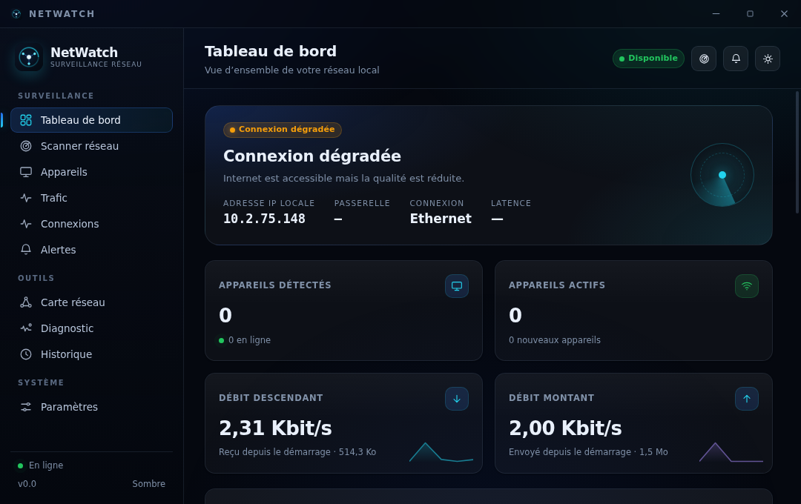
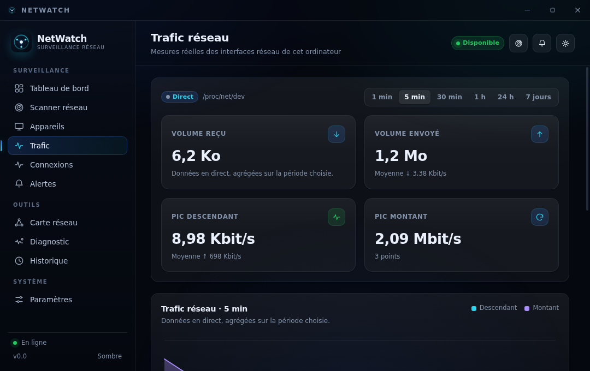
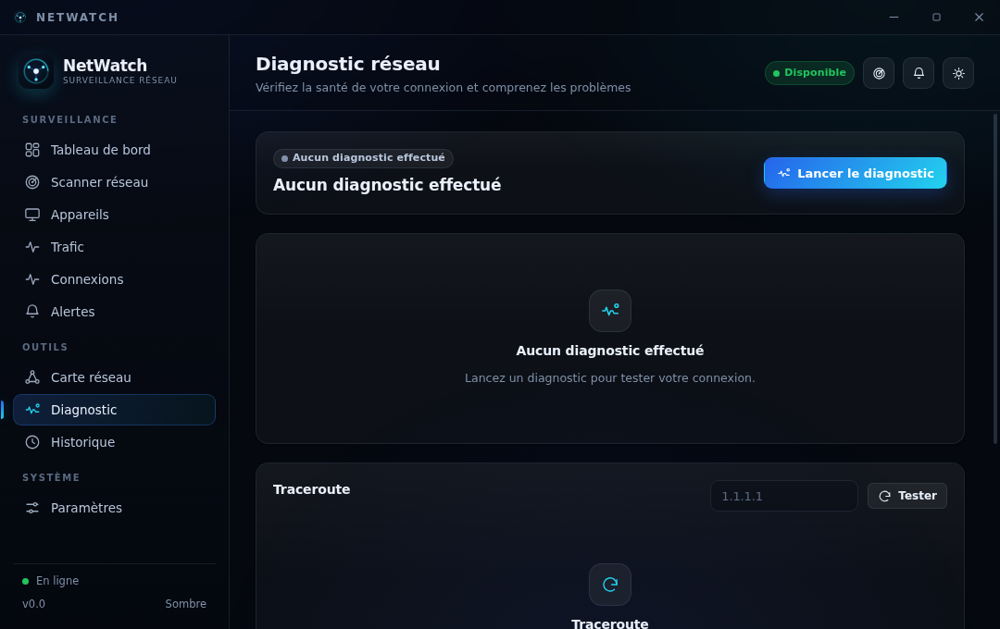
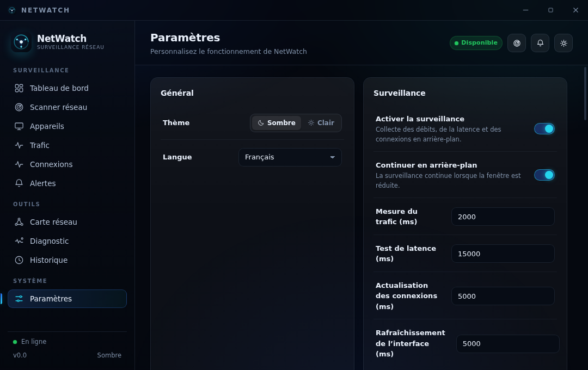
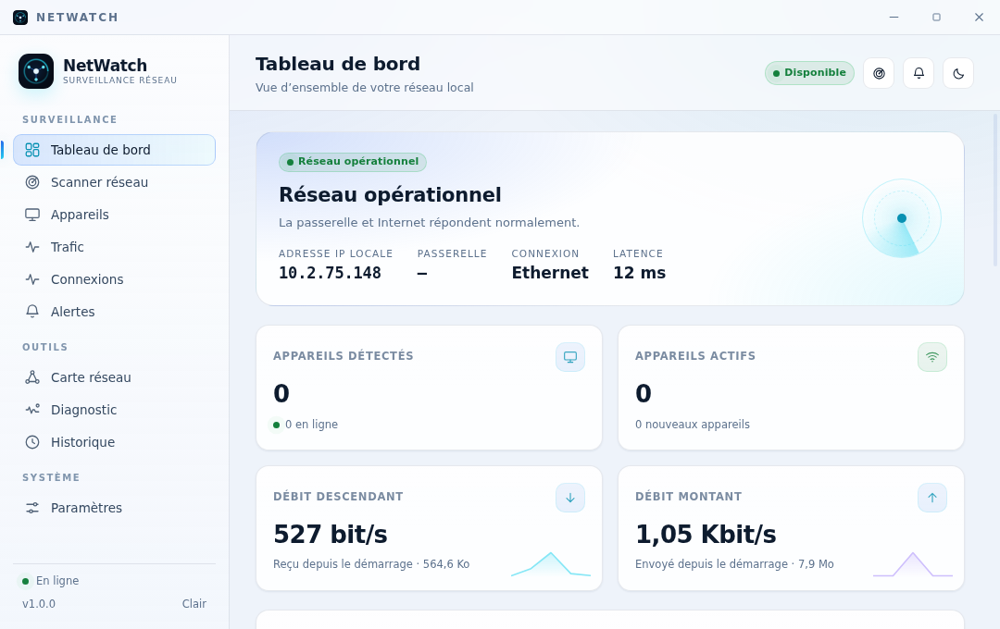

# NetWatch — Surveillance & analyse du réseau local

**NetWatch** est une application de bureau (Windows, Linux, macOS) qui permet de comprendre, surveiller et
analyser son réseau local. Toutes les données affichées proviennent de mesures réelles effectuées sur la
machine : aucun graphique, aucun appareil et aucune statistique ne sont simulés.

* Interface entièrement en français (anglais disponible), thème sombre et thème clair.
* Fonctionnement 100 % local : pas de compte, pas d'abonnement, pas de clé API, pas de serveur distant.
* Base SQLite locale pour l'historique, export CSV/JSON, alertes configurables.
* Installateur Windows, version portable et paquet Linux fournis par la chaîne de build.



---

## Sommaire

1. [Fonctionnalités](#1-fonctionnalités)
2. [Confidentialité et sécurité](#2-confidentialité-et-sécurité)
3. [Architecture](#3-architecture)
4. [Installation](#4-installation)
5. [Distribution (build)](#5-distribution-build)
6. [Données locales](#6-données-locales)
7. [Tests et qualité](#7-tests-et-qualité)
8. [Limitations connues](#8-limitations-connues)
9. [Dépannage](#9-dépannage)

---

## 1. Fonctionnalités

### 1.1 Tableau de bord

* État général du réseau (disponible / dégradé / hors ligne) calculé à partir des mesures de connectivité.
* Adresse IP locale, adresse IP publique (optionnelle), adresse MAC, passerelle, serveurs DNS.
* Nombre d'appareils détectés et d'appareils actuellement actifs.
* Débit descendant et montant en temps réel, latence courante, disponibilité Internet.
* Graphiques de débit alimentés par les compteurs réels des interfaces réseau.

### 1.2 Scanner réseau

* Analyse de la plage locale (CIDR) avec découverte des hôtes actifs : ICMP, table ARP du système et
  test de ports pour les machines qui filtrent l'ICMP.
* Récupération de l'adresse MAC (table ARP/`ip neigh`), du fabricant via une base OUI embarquée
  (40 562 préfixes, aucune requête réseau), du nom d'hôte (DNS inverse) et estimation du type d'appareil.
* Statut en ligne / hors ligne, première détection, dernière activité.
* Scan manuel, scan automatique planifié, comparaison entre deux scans.

### 1.3 Gestionnaire des appareils

* Liste filtrable et recherchable (IP, MAC, fabricant, nom, type, statut, étiquettes).
* Nom personnalisé, description, étiquettes libres, approbation (« appareil connu »).
* Détection des nouveaux appareils et des appareils inconnus (non approuvés).
* Fiche détaillée : ports ouverts détectés, historique de présence, changements d'état.

### 1.4 Surveillance du trafic

* Débit entrant/sortant mesuré sur les compteurs système (`/proc/net/dev`, `Get-NetAdapterStatistics`,
  `netstat -ib` selon la plateforme).
* Périodes d'analyse : 1 min, 5 min, 30 min, 1 h, 24 h, 7 jours.
* Volumes cumulés, pics, moyennes, agrégation par minute et historique journalier.
* Aucune valeur inventée : une période sans mesure affiche un état vide explicite.



### 1.5 Analyse des connexions

* Connexions TCP/UDP actives de la machine : processus, IP et port distants, port local, protocole, état.
* Sources système : `netstat -ano` (Windows), `ss`/`netstat` ou `/proc/net/*` (Linux), `lsof`/`netstat` (macOS).
* Recherche et filtres (protocole, état, processus), compteurs et principaux consommateurs.
* Le trafic par connexion n'est affiché que lorsque le système expose l'information.

### 1.6 Alertes intelligentes

* Nouvel appareil, appareil inconnu, appareil hors ligne, perte/retour d'Internet, latence élevée,
  débit inhabituel, changement d'adresse IP locale, changement de passerelle, échec DNS.
* Règles activables individuellement, seuils personnalisables, délai de repos anti-spam.
* Chaque alerte : horodatage, type, description, priorité, appareil concerné, acquittement.
* Notifications système (natives) filtrées par priorité minimale.

### 1.7 Historique et statistiques

* Journal des appareils, changements d'état, alertes, scans, mesures de débit et événements.
* Filtres par date et par catégorie, export CSV ou JSON.
* Purge automatique selon la durée de conservation configurée.

### 1.8 Diagnostic réseau

* Tests : connexion Internet, latence et gigue, perte de paquets, résolution DNS, passerelle,
  traceroute, inspection des interfaces, configuration locale.
* Chaque résultat est accompagné d'une explication en langage simple et d'une recommandation.
* Score de santé global et rapport exportable.



### 1.9 Carte du réseau et fonctions avancées

* Carte visuelle des appareils reliés à la passerelle, avec statut et type.
* Comparaison de deux scans, historique de présence, détection des variations de trafic.
* Surveillance de plusieurs interfaces, profils de surveillance (Équilibré, Discret, Intensif, Veille 24/7,
  plus profils personnalisés).

### 1.10 Paramètres

* Fréquence des scans, de rafraîchissement, des mesures de latence et des connexions.
* Notifications, thème (sombre/clair), langue (français/anglais).
* Conservation de l'historique, format d'export par défaut.
* Démarrage avec Windows, démarrage réduit, réduction dans la zone de notification.
* Seuils d'alerte, profils de surveillance, statistiques de la base, remise à zéro.



### 1.11 Thème clair

Le thème clair reprend la même hiérarchie visuelle avec des contrastes vérifiés.



---

## 2. Confidentialité et sécurité

| Principe | Mise en œuvre |
| --- | --- |
| Surveillance limitée au réseau autorisé | Le scan utilise la plage locale détectée ou la plage saisie par l'utilisateur ; aucune plage distante n'est scannée automatiquement. |
| Aucun scan externe non sollicité | Seuls des tests ponctuels de connectivité (ICMP/DNS vers 1.1.1.1, 8.8.8.8 et la passerelle) sont effectués ; ils sont désactivables. |
| Aucune collecte distante | Pas de télémétrie, pas d'analytics, pas de serveur. La seule requête sortante optionnelle récupère l'IP publique auprès d'un service public, et uniquement si l'utilisateur l'active. |
| Aucune donnée personnelle transmise | Tout reste dans la base SQLite locale. |
| Pas de compte ni de clé API | L'application démarre et fonctionne sans inscription. |
| Aucune exécution de commande arbitraire | Les commandes système sont définies dans le code, exécutées avec `execFile` (jamais de shell), avec des arguments séparés et validés. Aucune chaîne issue de l'interface n'est concaténée dans une ligne de commande. |
| Pas d'exploitation de vulnérabilité | Le scanner se limite à la découverte d'hôtes (ICMP, ARP, connexion TCP sur quelques ports courants). Aucune tentative d'exploit, de brute force ou d'élévation de privilèges. |
| Isolation de l'interface | `contextIsolation: true`, `nodeIntegration: false`, `sandbox` du renderer, preload exposant une API typée et fermée (`window.netwatch`). |
| Politique de sécurité du contenu | CSP stricte dans `index.html`, aucune ressource distante chargée. |
| Contrôle d'origine IPC | Chaque appel IPC vérifie la fenêtre émettrice, le cadre principal et l'URL (`file://` ou serveur de développement). Un appel venu d'une autre vue web est refusé et journalisé. |
| Permissions refusées | Toutes les permissions de session (caméra, micro, géolocalisation, notifications web, presse-papiers) sont refusées ; toute requête réseau du renderer vers un hôte non local est bloquée. |
| Validation des entrées | Les charges utiles IPC sont bornées et typées (longueurs, intervalles, énumérations) ; les cibles réseau passent par un validateur IPv4/CIDR/nom d'hôte avant tout appel système. |
| Mode local strict | Option de confidentialité qui supprime toute requête sortante : pas d'IP publique, pas de ping Internet, tests distants marqués « désactivés ». |
| Intégrité des données | Vérification `PRAGMA quick_check` au démarrage, mise en quarantaine d'une base corrompue (`.corrupt-<date>`), sauvegarde à chaud et restauration depuis les paramètres. |
| Aucun logiciel espion | Pas de keylogger, pas de capture d'écran, pas de surveillance de la navigation. |

NetWatch n'affirme jamais détecter une « attaque » : il signale des **anomalies** (nouvel appareil, variation de
débit, latence) et laisse l'utilisateur interpréter.

---

## 3. Architecture

```
NetWatch/
├── build/                     icônes générées (icon.png, icon.ico, tray.png)
├── docs/                      captures d'écran, limitations, architecture détaillée
├── resources/
│   └── oui.json               base fabricants (40 562 préfixes MAC), embarquée
├── scripts/
│   ├── generate-icons.mjs     génération des icônes (PNG/ICO, sans dépendance)
│   └── build-oui.mjs          régénération de la base OUI depuis les sources IEEE
├── src/
│   ├── main/                  processus principal Electron
│   │   ├── index.ts           fenêtre, tray, notifications, cycle de vie
│   │   ├── context.ts         assemblage des services et dépôts
│   │   ├── ipc.ts             contrat IPC ↔ implémentation (validation systématique)
│   │   ├── scheduler.ts       tâches périodiques (scan, trafic, latence, purge)
│   │   ├── alerts/engine.ts   moteur de règles et d'alertes
│   │   ├── data/
│   │   │   ├── database.ts            ouverture SQLite (WAL) + migrations
│   │   │   ├── export.ts              CSV/JSON + écriture disque
│   │   │   └── repositories/          appareils, alertes, événements, scans, trafic, latence…
│   │   ├── services/
│   │   │   ├── platform/              adaptateurs Windows / Linux / macOS + parseurs testés
│   │   │   ├── scanner.ts             découverte réseau
│   │   │   ├── traffic.ts             débits et séries temporelles
│   │   │   ├── connectivity.ts        Internet, latence, gigue, perte
│   │   │   ├── connections.ts         connexions actives et processus
│   │   │   ├── diagnostics.ts         tests de diagnostic
│   │   │   ├── network-info.ts        interfaces, route, DNS, IP publique
│   │   │   └── oui.ts                 lecture de la base fabricants
│   │   ├── settings/store.ts  paramètres validés + profils
│   │   └── logger.ts          journal local rotatif
│   ├── preload/index.ts       pont sécurisé (contextBridge)
│   ├── shared/                types, contrat IPC, libellés, utilitaires IP/format
│   └── renderer/              interface React + TypeScript
│       ├── pages/             Dashboard, Scanner, Devices, Traffic, Connections,
│       │                      Alerts, History, Diagnostics, NetworkMap, Settings
│       ├── components/        UI, graphiques SVG, icônes, mise en page
│       ├── hooks/             settings, données asynchrones, notifications
│       └── i18n/              français (défaut) et anglais
└── tests/                     suite Vitest (unitaires + intégration système réelle)
```

**Flux de données** : `renderer` → `window.netwatch` (preload) → `ipc.ts` (validation) → services → dépôts →
SQLite. Les mises à jour temps réel remontent par des canaux d'événements dédiés (`live:*`), sans polling
inutile côté interface.

**Découpage** : interface / services réseau / collecte / base de données / alertes / paramètres / exportation
sont des modules séparés, sans dépendance circulaire.

---

## 4. Installation

> Guide détaillé pas à pas (installateur, portable, Linux, sources, reconstruction des `.exe`,
> première utilisation) : **[docs/LANCEMENT.md](docs/LANCEMENT.md)**.

### 4.1 Utilisateur final (Windows)

1. Télécharger `NetWatch-1.0.0-setup.exe` (installateur) ou `NetWatch-1.0.0-portable.exe` (aucune installation)
   depuis la page **Releases** du dépôt.
2. Lancer le fichier. Aucun runtime externe n'est requis : Node.js, Electron et le module SQLite natif sont
   embarqués. Aucune compilation, aucun Python, aucun Visual Studio Build Tools.
3. L'installateur propose le dossier d'installation, crée un raccourci Bureau et Menu Démarrer, et enregistre
   la désinstallation dans « Applications et fonctionnalités ».

Installation silencieuse (déploiement en parc) :

```powershell
NetWatch-1.0.0-setup.exe /S                      # installation silencieuse
NetWatch-1.0.0-setup.exe /S /D=C:\Tools\NetWatch # dossier personnalisé
```

Désinstallation silencieuse :

```powershell
& "$env:LOCALAPPDATA\Programs\NetWatch\Uninstall NetWatch.exe" /S
```

Les données (base SQLite, journaux) vivent dans `%APPDATA%\NetWatch` et ne sont pas supprimées par
désinstallation, afin de conserver l'historique en cas de réinstallation. Le bouton « Ouvrir le dossier
de données » des paramètres y donne accès, et l'application propose sauvegarde et restauration de la base.

> Windows peut afficher un avertissement SmartScreen : le binaire n'est pas signé numériquement (aucun
> certificat de signature n'est fourni). Cliquer sur « Informations complémentaires » → « Exécuter quand même ».

### 4.2 Utilisateur final (Linux)

```bash
chmod +x NetWatch-1.0.0-x86_64.AppImage
./NetWatch-1.0.0-x86_64.AppImage
```

### 4.3 Développeur

Prérequis : Node.js ≥ 20 et npm.

```bash
npm ci               # installation reproductible (aucune compilation native)
npm run doctor       # vérifie SQLite natif, base OUI, icônes et build
npm run dev          # application en mode développement (rechargement à chaud)
npm run build        # compilation du processus principal, du preload et de l'interface
npm start            # exécution de la version compilée
npm test             # suite de tests Vitest
npm run typecheck    # vérification TypeScript (node + web)
```

`better-sqlite3` est distribué en binaire **N-API** (prebuilds Windows x64/arm64, Linux, macOS) : il n'y a
jamais de `node-gyp`, donc pas de Python ni de compilateur à installer. Si `npm run doctor` échoue, voir
la section [Dépannage](#9-dépannage).

Régénération des ressources :

```bash
npm run icons        # recrée build/icon.png, build/icon.ico, build/tray.png
npm run oui          # retélécharge la base IEEE et reconstruit resources/oui.json
```

---

## 5. Distribution (build)

Configuration : `electron-builder.yml`. Les binaires natifs de `better-sqlite3` (N-API) sont fournis pour toutes
les plateformes dans le paquet npm : aucune recompilation n'est nécessaire (`npmRebuild: false`).

```bash
npm run dist:win        # installateur NSIS + version portable (Windows x64)
npm run dist:portable   # version portable uniquement
npm run dist:linux      # AppImage (Linux x64)
npx electron-builder --mac   # dmg (à exécuter sous macOS)
```

Artefacts produits dans `release/` :

| Fichier | Description |
| --- | --- |
| `NetWatch-1.0.0-setup.exe` | Installateur Windows (NSIS, choix du dossier, raccourcis, désinstalleur) |
| `NetWatch-1.0.0-portable.exe` | Version portable Windows (aucune installation) |
| `NetWatch-1.0.0-x86_64.AppImage` | Paquet Linux autonome |
| `win-unpacked/` | Application Windows non empaquetée (débogage) |

Contenu embarqué : `app.asar` (code compilé), `app.asar.unpacked` (module SQLite), `oui.json` (base fabricants),
icônes. L'utilisateur final n'a besoin ni de Node.js, ni d'une configuration particulière.

**Compilation croisée depuis Linux** : l'installateur NSIS exige wine 64 **et** 32 bits (le désinstalleur est
généré en exécutant le stub 32 bits) ainsi qu'un affichage virtuel. Détail et commandes exactes dans
[docs/LANCEMENT.md](docs/LANCEMENT.md#compilation-croisée-depuis-linux). Sous Windows, aucune dépendance
supplémentaire n'est nécessaire.

Derniers artefacts vérifiés (build du 27/11/2026, Windows x64) :

| Fichier | Taille | SHA-256 |
| --- | --- | --- |
| `NetWatch-1.0.0-setup.exe` | 129 209 789 octets | `b9c38ac1b549a41fff6821d26a9909f05a484075bd048bb5feeefdf28d3c2398` |
| `NetWatch-1.0.0-portable.exe` | 117 224 755 octets | `0ba5574ab8b17aa5b616271fea5891ee3ef3499ff541f9eeb64333dc69f33c53` |

Contrôle de l'installateur : il contient `$PLUGINSDIR/app-64.7z` (charge utile de l'application) et
`$R0/Uninstall NetWatch.exe` (désinstalleur), ce qui garantit une désinstallation propre enregistrée dans
« Applications et fonctionnalités ».

**Signature** : aucun certificat n'est configuré ; pour signer, renseigner `win.certificateFile` et
`win.certificatePassword` (ou les variables d'environnement `CSC_LINK` / `CSC_KEY_PASSWORD`) avant le build.

---

## 6. Données locales

| Élément | Emplacement |
| --- | --- |
| Base SQLite | Windows : `%APPDATA%\NetWatch\netwatch.db` · Linux : `~/.config/NetWatch/netwatch.db` · macOS : `~/Library/Application Support/NetWatch/netwatch.db` |
| Journaux | même dossier (`logs/`) |
| Exports | dossier choisi par l'utilisateur lors de l'export |

* Mode WAL, migrations automatiques versionnées.
* Purge automatique selon `retention.days` (30 jours par défaut) et `retention.maxAlerts`.
* Paramètres accessibles depuis « Paramètres → À propos / Base de données » (boutons « Ouvrir les données »,
  « Ouvrir les journaux », remise à zéro).

---

## 7. Tests et qualité

```bash
npm test          # 144 tests
npm run typecheck # TypeScript strict, projets node et web
```

Couverture fonctionnelle :

| Domaine | Fichier de tests |
| --- | --- |
| Base SQLite, migrations, dépôts | `tests/database.test.ts` |
| Scanner réseau (CIDR, ARP, ports, limites) | `tests/scanner.test.ts` |
| Utilitaires IP, masques, CIDR | `tests/iputil.test.ts` |
| Parseurs système (ping, ARP, netstat, ss, /proc) | `tests/platform-parsers.test.ts` |
| Moteur d'alertes (règles, seuils, repos, notifications) | `tests/alerts.test.ts` |
| Export CSV/JSON (échappement, en-têtes, formats) | `tests/export.test.ts` |
| Paramètres, validation, profils, persistance | `tests/settings.test.ts` |
| Sécurité Electron (origine IPC, cadres, fenêtre) | `tests/security.test.ts` |
| Validation des charges utiles IPC (hôtes, bornes) | `tests/validation.test.ts` |
| Intégrité, sauvegarde et récupération SQLite | `tests/database-integrity.test.ts` |
| Intégration système réelle (ping, ARP, connexions, compteurs, diagnostic, trafic) | `tests/services.test.ts` |

Les tests d'intégration exécutent les véritables adaptateurs système : ils mesurent des compteurs réels,
ouvrent de vraies sockets et lisent les tables du système d'exploitation (aucune donnée simulée, aucun mock
du code testé).

Vérifications manuelles effectuées : lancement de l'application compilée, capture des 10 pages, exécution de la
version empaquetée (AppImage) avec chargement de la base OUI depuis `process.resourcesPath`, création de la base
SQLite dans le dossier utilisateur.

---

## 8. Limitations connues

1. **Découverte réseau dépendante du système** : l'ICMP et la lecture ARP peuvent être bloqués par le réseau
   (isolation client Wi-Fi, pare-feu, VLAN). NetWatch complète alors la détection par un test de ports, mais un
   appareil totalement silencieux peut rester invisible.
2. **Sans outil `ping`** (certains conteneurs Linux), la latence est mesurée par établissement TCP et signalée
   comme telle (`method: 'tcp'`).
3. **Trafic par application** : les compteurs système sont globaux par interface. Le détail par application n'est
   affiché que lorsque la plateforme l'expose (association connexion ↔ processus) ; NetWatch n'installe aucun
   pilote de capture de paquets.
4. **Détection d'anomalies** : NetWatch signale des écarts mesurables (nouvel appareil, latence, débit), jamais
   une intrusion confirmée.
5. **Traceroute** nécessite l'outil système (`tracert`/`traceroute`) ; sinon le test est marqué « non disponible ».
6. **IP publique** : nécessite une connexion sortante et l'accord explicite de l'utilisateur (désactivé par défaut).
7. **Signature de code** : les binaires fournis ne sont pas signés ; SmartScreen peut demander une confirmation.
8. **Windows ARM64** : binaires fournis pour x64 ; un build `--arm64` est possible (`electron-builder --win --arm64`).

---

## 9. Dépannage

### `npm ci` n'installe pas Electron / erreur `Electron failed to install correctly`

Depuis Electron 45, le binaire n'est plus téléchargé par un script `postinstall` : il est récupéré au premier
`npm run dev` (ou `npm start`). Si le téléchargement échoue (proxy, pare-feu), relancez :

```bash
npx install-electron      # téléchargement explicite du binaire
npm run dev
```

### Avertissement npm 12 « install scripts blocked »

Le projet déclare une politique explicite dans `package.json` :

```json
"allowScripts": {
  "electron-winstaller": true,
  "better-sqlite3": false
}
```

`better-sqlite3` est volontairement **refusé** : il est livré en binaire N-API (`prebuilds/`), donc `node-gyp`,
Python et Visual Studio ne sont jamais nécessaires. Si votre npm est antérieur à cette fonctionnalité, le champ
est simplement ignoré.

### `npm run doctor` signale `better-sqlite3`

```bash
rm -rf node_modules package-lock.json && npm install   # ou : npm rebuild better-sqlite3
npm run doctor
```

Vérifiez aussi que `node_modules/better-sqlite3/prebuilds/` contient bien `win32-x64.node` (ou la variante de
votre plateforme) : un antivirus trop strict peut supprimer ce fichier.

### La base de données est signalée comme corrompue

Au démarrage, une base illisible est renommée `netwatch.db.corrupt-<horodatage>` et une base neuve est créée ;
l'application démarre donc toujours. Pour récupérer l'historique, utilisez **Paramètres → Sauvegarder /
Restaurer** avec une sauvegarde antérieure. Les fichiers `.corrupt-*` restent dans le dossier de données pour
analyse.

### La page « Connexions » est vide

La liste des connexions provient de `netstat`/`ss`/`Get-NetTCPConnection`. Sous Windows, les connexions d'autres
utilisateurs et les PID protégés peuvent être masqués ; sous Linux, `ss -p` nécessite des droits sur `/proc`.
NetWatch n'élève jamais ses privilèges automatiquement.

| Symptôme | Cause probable | Solution |
| --- | --- | --- |
| « Impossible de déterminer automatiquement le réseau local » | Interface sans sous-réseau IPv4 exploitable (VPN, /32, lien point à point) | Saisir une plage manuellement (ex. `192.168.1.0/24`) dans le scanner. |
| Aucun appareil détecté | Réseau isolé, ICMP filtré, plage incorrecte | Vérifier la plage, relancer un scan, consulter « Diagnostic ». |
| Latence « — » | ICMP bloqué par le réseau ou l'outil `ping` absent | Le diagnostic indique la méthode utilisée ; la connectivité Internet reste mesurée par DNS/TCP. |
| Connexions vides | Droits insuffisants pour lire les processus d'autres utilisateurs | Lancer l'application avec des droits suffisants ; les connexions de l'utilisateur courant restent visibles. |
| Notifications absentes | Notifications désactivées ou priorité minimale trop élevée | Paramètres → Notifications. |
| Base verrouillée après un arrêt brutal | Fichier WAL en cours de récupération | Relancer l'application ; SQLite récupère automatiquement. |

Journaux : `Paramètres → Ouvrir les journaux`.

---

## Licence

MIT. Les données OUI proviennent des registres publics IEEE ; voir `resources/oui.json` et `scripts/build-oui.mjs`.
